I write backend services in Java for a living: promotion and pricing engines, Kafka consumers, search on OpenSearch.
After hours I build small tools that give AI coding agents better eyes on real systems, mostly MCP servers.

  
  
  
  

<picture>
  <source media="(prefers-color-scheme: dark)" srcset="https://raw.githubusercontent.com/ntbang0901/ntbang0901/output/github-snake-dark.svg">
  
</picture>
